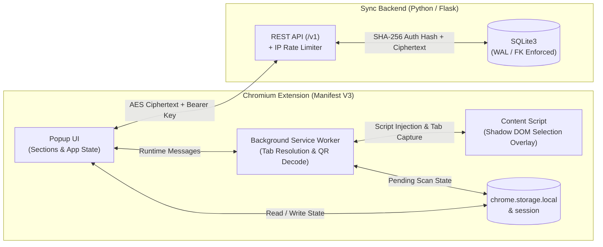

<div align="center">

# Authenticator For PC

**A zero-knowledge, cloud-synced 2FA desktop browser extension with on-screen QR code capture and a lightweight Flask REST backend.**

[](#architecture-overview)
[](#project-structure)
[](#backend-api--database-design)
[](#security--cryptographic-model)

</div>

---

## Table of Contents

1. [Overview](#overview)
2. [Key Features](#key-features)
3. [Architecture Overview](#architecture-overview)
4. [Security & Cryptographic Model](#security--cryptographic-model)
5. [Project Structure](#project-structure)
6. [Backend API & Database Design](#backend-api--database-design)
7. [Getting Started](#getting-started)
8. [Author](#author)

---

## Overview

**Authenticator For PC** is a full-stack two-factor authentication (2FA) solution built as a Chromium Manifest V3 extension paired with a stateless Python/Flask synchronization API.

Designed with **privacy, modularity, and deterministic state management** as first-class principles, the extension performs all OTP generation (RFC 6238 TOTP & RFC 4226 HOTP) and vault encryption **entirely on the client**. Account vaults are encrypted using the user's 24-digit account key via AES before ever leaving the browser, while the backend only stores a `SHA-256` hash of the authentication key alongside the opaque ciphertext payload.

---

## Key Features

- **RFC-Compliant TOTP & HOTP Generation:** Supports `SHA-1`, `SHA-256`, and `SHA-512` HMAC algorithms, custom digit lengths, time periods, and HOTP counters.
- **On-Screen QR Code Region Scanner:** Built-in screen capture workflow using a Shadow DOM crosshair overlay, `chrome.tabs.captureVisibleTab`, offscreen canvas cropping, and `jsQR` decoding—allowing users to drag-select any QR code directly on a webpage (`otpauth://` and `apple-otpauth://`).
- **Zero-Knowledge Cloud Sync & Merge Pipeline:** Automatically reconciles local `ready`, `pending`, and remote `restored` account states by ID so offline additions or edits seamlessly merge with cloud backups.
- **Account-Number Authentication (No Email/Password Required):** Generates a cryptographically random 24-digit account key (`secrets` module) that serves both as the session credential (hashed via `SHA-256` for API verification) and the client-side AES encryption secret.
- **Design-Token CSS System:** Built from scratch without heavy UI frameworks using a strict token/primitive/section CSS architecture (`tokens/`, `primitives/`, `sections/`, `overlay/`) with choreographed hardware-accelerated transitions.

---

## Architecture Overview

The system is divided into four isolated runtime contexts that communicate over well-defined boundaries:



### Engineering Highlights

- **1:1 Unbundled ES Module Build Pipeline (`.pmgr/build.js`):** Bundles third-party dependencies (`crypto-js`, `jsqr`, `@fortawesome/fontawesome-free`) via `esbuild` into `/dependencies` while mirroring application source files 1:1 with `@/` alias resolution—keeping production extension code human-readable, auditable, and strictly compliant with Manifest V3 Content Security Policy (`script-src 'self'`).
- **Shadow DOM Style Isolation:** The in-page QR scanner mounts inside a closed Shadow DOM root (`attachShadow({ mode: "closed" })`) so host webpage CSS rules cannot bleed into or disrupt the selection overlay.
- **Atomic Service Layer:** Every service operation (`account`, `crypto`, `otp`, `remote`, `scan`, `shell`, `vault`) is decomposed into single-purpose modules organized by domain and action verb.

---

## Security & Cryptographic Model

| Layer | Implementation | Purpose |
| :--- | :--- | :--- |
| **Account Key Generation** | Python `secrets.choice` (24-digit numeric key) | High-entropy, human-exportable credential without PII |
| **Server Authentication** | `SHA-256(auth_key)` stored in SQLite `sessions` | Server never stores the raw 24-digit key in plaintext |
| **Vault Encryption** | Client-side `CryptoJS.AES.encrypt(json, auth_key)` | Server only receives and stores opaque ciphertext (`payload`) |
| **Extension CSP** | `script-src 'self'; object-src 'self'` | Prevents inline script execution and remote code injection |
| **API Rate Limiting** | Sliding-window SQLite IP + endpoint limiter | Protects `/v1/*` endpoints with `429 Too Many Requests` & `Retry-After` headers |

---

## Project Structure

```text
PC Authenticator/
├── .pmgr/                              # Build & bundling toolchain (Bun / Vite / esbuild)
│   ├── build.js                        # 1:1 ESM mirror builder & dependency bundler
│   ├── package.json                    # Frontend dependencies & scripts
│   └── vite.config.js                  # Vite dev server & CRX configuration
└── project/
    ├── backend/                        # Python Flask synchronization API
    │   ├── domains/
    │   │   ├── auth/                   # Session creation, verification, and deletion
    │   │   └── vault/                  # Encrypted vault fetch and upsert endpoints
    │   ├── services/
    │   │   └── limits.py               # Per-IP, per-endpoint sliding-window rate limiter
    │   ├── utils/                      # DB connection, SHA-256 auth helpers, CORS, JSON responses
    │   ├── config.py                   # Environment configuration
    │   └── main.py                     # Application factory entrypoint
    └── src/                            # Chrome Extension source (Manifest V3)
        ├── css/
        │   ├── tokens/                 # Design tokens (color, layout, motion, typography, controls)
        │   ├── primitives/             # CSS reset & extension frame shell
        │   ├── sections/               # Scoped styles & keyframe animations per UI section
        │   ├── overlay/                # Shadow DOM stylesheet for on-page QR scanner
        │   └── popup.css               # Stylesheet entry point
        ├── html/
        │   └── index.html              # Extension popup DOM structure & templates
        ├── js/
        │   ├── app/                    # Application bootstrap & reactive state store
        │   ├── const/                  # Centralized constants, selectors, and timing tokens
        │   ├── sections/               # UI section controllers & animation orchestrators
        │   │   ├── body/
        │   │   ├── codes/
        │   │   ├── header/
        │   │   ├── manual-menu/
        │   │   ├── qr-menu/
        │   │   ├── search-bar/
        │   │   └── user-menu/
        │   └── services/               # Domain service layer
        │       ├── account/            # Sign-in, sign-up, sign-out, storage, and API client
        │       ├── crypto/             # Client-side AES encrypt/decrypt actions
        │       ├── otp/                # RFC 4226/6238 HOTP & TOTP generation engine
        │       ├── remote/             # Remote vault backup & restore HTTP client
        │       ├── scan/               # Service worker, content script, and tab capture logic
        │       ├── shell/              # Extension popup window management
        │       └── vault/              # Vault CRUD, URI parsing, record sanitization, & sync merge
        └── manifest.json               # Chrome Extension Manifest V3 definition
```

---

## Backend API & Database Design

### REST Endpoints (`/v1`)

| Method | Endpoint | Auth | Description |
| :--- | :--- | :--- | :--- |
| `POST` | `/v1/auth/sessions` | None | Generates a new 24-digit `auth_key`, stores its `SHA-256` hash, and returns the key (`201`). |
| `GET` | `/v1/auth/sessions` | Query / Header | Verifies whether the provided `auth_key` corresponds to an active session (`200` / `401`). |
| `DELETE` | `/v1/auth/sessions` | `Bearer` / `X-Auth-Key` | Deletes the session and cascades deletion to the associated encrypted vault (`200`). |
| `GET` | `/v1/vault` | `Bearer` / `X-Auth-Key` | Retrieves the encrypted vault `payload` and `updated_at` timestamp for the session (`200`). |
| `PUT` | `/v1/vault` | `Bearer` / `X-Auth-Key` | Upserts the encrypted vault `payload` (validated up to 64 KB) and returns `updated_at` (`200`). |

### Database Schema (SQLite)

- **`sessions`**: `id (PK)`, `auth_hash (TEXT UNIQUE)`, `created_at (TIMESTAMP)`
- **`vaults`**: `session_id (PK, FK -> sessions.id ON DELETE CASCADE)`, `payload (TEXT)`, `updated_at (TIMESTAMP)`
- **`rate_limit_events`**: `id (PK)`, `ip (TEXT)`, `endpoint (TEXT)`, `created_at (INTEGER)`

---

## Getting Started

### Prerequisites

- **[Bun](https://bun.sh/)** (v1.0+) or **Node.js** (v18+) for building the extension
- **Python** (v3.10+) for running the synchronization backend (optional for local UI testing)

### 1. Build the Browser Extension

```bash
cd .pmgr
bun install
bun run build
```

For live rebuilds during development:

```bash
bun run watch
```

### 2. Load the Extension in Chrome / Edge / Brave

1. Open `chrome://extensions` in your browser.
2. Enable **Developer mode** (top-right toggle).
3. Click **Load unpacked** and select the generated `.pmgr/dist` directory.

### 3. Run the Backend API Locally (Optional)

```bash
cd project/backend
python -m venv .venv
# Windows:
.venv\Scripts\activate
# macOS / Linux:
source .venv/bin/activate

pip install -r requirements.txt

# Set required environment variables
export DB_PATH="authenticator.db"
export RATE_LIMIT_AMOUNT="60"
export RATE_LIMIT_WINDOW="60"

python main.py
```

---

## Author

**Christos Evlidis**
- GitHub: [@christos-evlidis](https://github.com/christos-evlidis)

