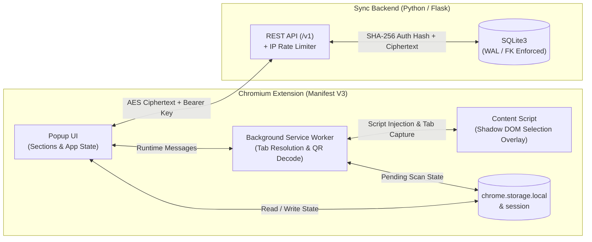

<div align="center">

# Authenticator For PC

**A zero-knowledge, cloud-synced 2FA desktop browser extension with on-screen QR code capture and a lightweight Flask REST backend.**

[](#architecture-overview)
[](#project-structure)
[](#backend-api--database-design)
[](#security--cryptographic-model)

</div>

---

## Overview

**Authenticator For PC** is a full-stack two-factor authentication (2FA) solution built as a Chromium Manifest V3 extension paired with a stateless Python/Flask synchronization API.

Designed with **privacy, modularity, and deterministic state management** as first-class principles, the extension performs all OTP generation (RFC 6238 TOTP & RFC 4226 HOTP) and vault encryption **entirely on the client**. Account vaults are encrypted using the user's 24-digit account key via AES before ever leaving the browser, while the backend only stores a `SHA-256` hash of the authentication key alongside the opaque ciphertext payload.

---

## Key Features

- **RFC-Compliant TOTP & HOTP Generation:** Supports `SHA-1`, `SHA-256`, and `SHA-512` HMAC algorithms, custom digit lengths, time periods, and HOTP counters.
- **On-Screen QR Code Region Scanner:** Built-in screen capture workflow using a Shadow DOM crosshair overlay, `chrome.tabs.captureVisibleTab`, offscreen canvas cropping, and `jsQR` decoding—allowing users to drag-select any QR code directly on a webpage (`otpauth://` and `apple-otpauth://`).
- **Zero-Knowledge Cloud Sync & Merge Pipeline:** Automatically reconciles local `ready`, `pending`, and remote `restored` account states by ID so offline additions or edits seamlessly merge with cloud backups.
- **Account-Number Authentication (No Email/Password Required):** Generates a cryptographically random 24-digit account key (`secrets` module) that serves both as the session credential (hashed via `SHA-256` for API verification) and the client-side AES encryption secret.
- **Design-Token CSS System:** Built from scratch without heavy UI frameworks using a strict token/primitive/section CSS architecture (`tokens/`, `primitives/`, `sections/`, `overlay/`) with choreographed hardware-accelerated transitions.

---

## Architecture Overview

The system is divided into four isolated runtime contexts that communicate over well-defined boundaries:



### Engineering Highlights

- **1:1 Unbundled ES Module Build Pipeline (`.pmgr/build.js`):** Bundles third-party dependencies (`crypto-js`, `jsqr`, `@fortawesome/fontawesome-free`) via `esbuild` into `/dependencies` while mirroring application source files 1:1 with `@/` alias resolution—keeping production extension code human-readable, auditable, and strictly compliant with Manifest V3 Content Security Policy (`script-src 'self'`).
- **Shadow DOM Style Isolation:** The in-page QR scanner mounts inside a closed Shadow DOM root (`attachShadow({ mode: "closed" })`) so host webpage CSS rules cannot bleed into or disrupt the selection overlay.
- **Atomic Service Layer:** Every service operation (`account`, `crypto`, `otp`, `remote`, `scan`, `shell`, `vault`) is decomposed into single-purpose modules organized by domain and action verb.

---

## Security & Cryptographic Model

| Layer | Implementation | Purpose |
| :--- | :--- | :--- |
| **Account Key Generation** | Python `secrets.choice` (24-digit numeric key) | High-entropy, human-exportable credential without PII |
| **Server Authentication** | `SHA-256(auth_key)` stored in SQLite `sessions` | Server never stores the raw 24-digit key in plaintext |
| **Vault Encryption** | Client-side `CryptoJS.AES.encrypt(json, auth_key)` | Server only receives and stores opaque ciphertext (`payload`) |
| **Extension CSP** | `script-src 'self'; object-src 'self'` | Prevents inline script execution and remote code injection |
| **API Rate Limiting** | Sliding-window SQLite IP + endpoint limiter | Protects `/v1/*` endpoints with `429 Too Many Requests` & `Retry-After` headers |

---

## Project Structure

```text
PC Authenticator/
├── .gitignore                                              # Ignored build artifacts, virtualenvs, and local databases
├── README.md                                               # Project documentation and architectural reference
├── .pmgr/                                                  # Build and bundling toolchain (Bun / Vite / esbuild)
│   ├── build.js                                            # 1:1 ESM mirror builder and third-party dependency bundler
│   ├── bun.lock                                            # Deterministic Bun dependency lockfile
│   ├── package.json                                        # Frontend scripts and package dependencies
│   └── vite.config.js                                      # Vite dev server and Chrome Extension (CRX) configuration
└── project/                                                # Core application workspace
    ├── backend/                                            # Python Flask synchronization REST API
    │   ├── config.py                                       # Environment variable loader (DB path, rate limit settings)
    │   ├── main.py                                         # Flask application factory and blueprint registration
    │   ├── requirements.txt                                # Python backend package dependencies
    │   ├── domains/                                        # Feature-scoped API domain modules
    │   │   ├── auth/                                       # Session authentication domain
    │   │   │   ├── actions.py                              # Session creation, SHA-256 verification, and deletion logic
    │   │   │   └── routes.py                               # /v1/auth/sessions HTTP route handlers
    │   │   └── vault/                                      # Encrypted vault synchronization domain
    │   │       ├── actions.py                              # Vault ciphertext retrieval and upsert database operations
    │   │       └── routes.py                               # /v1/vault GET and PUT HTTP route handlers
    │   ├── services/                                       # Cross-cutting backend services
    │   │   └── limits.py                                   # Sliding-window IP and endpoint SQLite rate limiter
    │   └── utils/                                          # Shared backend helper utilities
    │       ├── auth.py                                     # 24-digit key generator, SHA-256 hashing, and header extraction
    │       ├── cors.py                                     # Cross-Origin Resource Sharing header middleware
    │       ├── db.py                                       # SQLite connection manager and schema initialization
    │       ├── responses.py                                # Standardized JSON success and error response builders
    │       └── vault.py                                    # Vault payload size (64 KB) and string type validation
    └── src/                                                # Chrome Extension source code (Manifest V3)
        ├── manifest.json                                   # Extension permissions, CSP, service worker, and popup config
        ├── html/                                           # Extension markup
        │   └── index.html                                  # Popup DOM shell, section containers, and account card template
        ├── icons/                                          # Extension branding assets
        │   └── light/                                      # Light-theme toolbar and store icons
        │       ├── icon16.png                              # 16x16 favicon and toolbar icon
        │       ├── icon48.png                              # 48x48 extension management page icon
        │       └── icon128.png                             # 128x128 Chrome Web Store and install dialog icon
        ├── css/                                            # Layered stylesheet architecture
        │   ├── popup.css                                   # Main stylesheet entrypoint importing tokens, primitives, and sections
        │   ├── overlay/                                    # Content-script styles
        │   │   └── scan.css                                # Closed Shadow DOM styles for the on-page QR selection overlay
        │   ├── primitives/                                 # Structural base styles
        │   │   ├── frame.css                               # Fixed popup viewport dimensions and root shell layout
        │   │   └── reset.css                               # Box-sizing, margin, and typography normalization
        │   ├── tokens/                                     # CSS custom property design tokens
        │   │   ├── color.css                               # Semantic surface, text, border, and status color palette
        │   │   ├── controls.css                            # Interactive button, input, and focus ring tokens
        │   │   ├── layout.css                              # Spacing scale, border radii, and z-index layers
        │   │   ├── motion.css                              # Transition durations and cubic-bezier easing curves
        │   │   └── typography.css                          # Font families, weights, sizes, and line heights
        │   └── sections/                                   # Component-scoped stylesheets and animations
        │       ├── body/                                   # Main popup body container styles
        │       │   ├── animation.css                       # Body transition and view-switching keyframes
        │       │   └── body.css                            # Body layout, scrolling, and background rules
        │       ├── codes/                                  # 2FA account cards list styles
        │       │   └── codes.css                           # Account card grid, inline edit fields, and countdown ring styles
        │       ├── header/                                 # Top navigation bar styles
        │       │   ├── animation.css                       # Header button and icon transition animations
        │       │   └── header.css                          # Header toolbar alignment and action button layout
        │       ├── manual-menu/                            # Manual OTP secret entry drawer styles
        │       │   ├── animation.css                       # Slide-in/out drawer transition keyframes
        │       │   └── manual-menu.css                     # Form inputs, validation states, and submit button layout
        │       ├── qr-menu/                                # QR code scan trigger menu styles
        │       │   ├── animation.css                       # QR menu open/close transition keyframes
        │       │   └── qr-menu.css                         # QR menu layout and status prompt styling
        │       ├── search-bar/                             # Real-time account filter bar styles
        │       │   ├── animation.css                       # Search bar expand/collapse transition keyframes
        │       │   └── search-bar.css                      # Search input field and clear button layout
        │       └── user-menu/                              # Cloud sync and account key management drawer styles
        │           ├── animation.css                       # User menu drawer transition keyframes
        │           └── user-menu.css                       # Account key display, sign-in input, and sync status styles
        └── js/                                             # Modular ES Module application logic
            ├── app/                                        # Application core and state management
            │   ├── app.index.js                            # Popup bootstrap, section mounting, and initial sync trigger
            │   └── app.state.js                            # Centralized reactive state store and event pub/sub bus
            ├── const/                                      # Domain and UI section constants
            │   ├── const.auth.js                           # Authentication API endpoints, storage keys, and key length rules
            │   ├── const.body.js                           # Body section DOM selectors and state class names
            │   ├── const.codes.js                          # Account list selectors, copy feedback timings, and UI labels
            │   ├── const.data.js                           # Chrome storage keys for vault states (ready, pending, restored)
            │   ├── const.header.js                         # Header button selectors and navigation action identifiers
            │   ├── const.manual-menu.js                    # Manual setup form selectors and validation messages
            │   ├── const.otp.js                            # Default TOTP/HOTP algorithms, digit counts, and period intervals
            │   ├── const.qr-menu.js                        # QR menu selectors and scan status copy
            │   ├── const.scan.js                           # Runtime message types, script paths, and scan overlay constants
            │   ├── const.search-bar.js                     # Search input selectors and filter event constants
            │   └── const.user-menu.js                      # User menu selectors, sync status indicators, and auth labels
            ├── sections/                                   # UI section controllers and animation orchestrators
            │   ├── sections.index.js                       # Barrel export aggregating all popup UI section modules
            │   ├── body/                                   # Main viewport container controller
            │   │   ├── body.animations.js                  # Coordinates body state transitions across active menus
            │   │   └── body.index.js                       # Initializes body DOM bindings and view-state listeners
            │   ├── codes/                                  # 2FA code list and inline card editor controller
            │   │   ├── codes.animations.js                 # Card insertion, deletion, and copy-feedback animations
            │   │   └── codes.index.js                      # Live TOTP ticker, click-to-copy, search filtering, and inline editing
            │   ├── header/                                 # Top navigation toolbar controller
            │   │   ├── header.animations.js                # Toolbar button active-state and icon morph animations
            │   │   └── header.index.js                     # Binds search, QR menu, manual menu, and user menu toggles
            │   ├── manual-menu/                            # Manual 2FA account entry controller
            │   │   ├── manual-menu.animations.js           # Controls manual entry panel open/close transitions
            │   │   └── manual-menu.index.js                # Handles manual form validation, secret parsing, and vault insertion
            │   ├── qr-menu/                                # QR scan initiation menu controller
            │   │   ├── qr-menu.animations.js               # Controls QR scan panel open/close transitions
            │   │   └── qr-menu.index.js                    # Dispatches scan start requests to the background service worker
            │   ├── search-bar/                             # Account search filter controller
            │   │   ├── search-bar.animations.js            # Controls search bar reveal and focus transitions
            │   │   └── search-bar.index.js                 # Captures query input and broadcasts live filter updates
            │   └── user-menu/                              # Cloud account and sync status controller
            │       ├── user-menu.animations.js             # Controls user menu drawer open/close transitions
            │       └── user-menu.index.js                  # Manages key generation, sign-in/out flows, and cloud sync triggers
            └── services/                                   # Domain service layer
                ├── account/                                # Account authentication and session lifecycle service
                │   ├── account.index.js                    # Public facade for account authentication operations
                │   ├── action/                             # High-level account workflows
                │   │   ├── sign-in.js                      # Verifies an existing 24-digit key and restores the remote vault
                │   │   ├── sign-out.js                     # Clears local session credentials and resets sync state
                │   │   └── sign-up.js                      # Requests a new 24-digit account key and initializes cloud backup
                │   ├── api/                                # Backend /v1/auth HTTP clients
                │   │   ├── create.js                       # POST /v1/auth/sessions request to provision a new account key
                │   │   └── verify.js                       # GET /v1/auth/sessions request to validate an existing key
                │   ├── sanitize/                           # Credential input sanitizers
                │   │   └── number.js                       # Strips non-digits and validates 24-digit account numbers
                │   └── storage/                            # Local session persistence helpers
                │       ├── clear.js                        # Removes stored authentication credentials from chrome.storage
                │       ├── get.js                          # Reads the active authentication key from chrome.storage
                │       └── set.js                          # Persists the active authentication key to chrome.storage
                ├── crypto/                                 # Client-side cryptographic service
                │   ├── crypto.index.js                     # Public facade for vault encryption and decryption
                │   ├── action/                             # Symmetric AES cipher operations
                │   │   ├── decrypt.js                      # Decrypts AES ciphertext payloads using the user's account key
                │   │   └── encrypt.js                      # Encrypts serialized vault JSON using AES and the user's key
                │   └── type/                               # Cryptographic payload validators
                │       └── encrypted.js                    # Verifies whether a value is a non-empty encrypted payload string
                ├── otp/                                    # One-Time Password generation engine
                │   ├── otp.index.js                        # Public facade for OTP token generation and countdown metrics
                │   ├── action/                             # Token generation entrypoint
                │   │   └── generate.js                     # Dispatches OTP calculation to TOTP or HOTP generators
                │   ├── type/                               # RFC algorithm implementations
                │   │   ├── hotp.js                         # RFC 4226 HMAC-based One-Time Password implementation
                │   │   └── totp.js                         # RFC 6238 Time-based One-Time Password implementation
                │   └── util/                               # Cryptographic and timing helpers
                │       ├── clock.js                        # Computes current Unix epoch time-step windows and remaining seconds
                │       ├── counter.js                      # Converts integer counters into 8-byte big-endian buffers
                │       └── options.js                      # Normalizes OTP parameters (algorithm, digits, period, secret)
                ├── remote/                                 # Cloud vault transport service
                │   ├── remote.index.js                     # Public facade for remote vault backup and restore calls
                │   └── action/                             # Backend /v1/vault HTTP clients
                │       ├── backup.js                       # PUT /v1/vault client that uploads AES-encrypted vault payloads
                │       └── restore.js                      # GET /v1/vault client that downloads AES-encrypted vault payloads
                ├── scan/                                   # On-screen QR code capture and decoding service
                │   ├── scan.index.js                       # Popup-facing facade for initiating scans and consuming results
                │   ├── content/                            # Injected webpage content-script modules
                │   │   ├── content.index.js                # Content-script entrypoint listening for worker scan commands
                │   │   ├── overlay/                        # Interactive crosshair selection UI
                │   │   │   ├── create.js                   # Mounts the closed Shadow DOM host and selection canvas
                │   │   │   ├── remove.js                   # Tears down the Shadow DOM overlay and restores page state
                │   │   │   ├── start.js                    # Handles pointer drag selection coordinates and escape cancellation
                │   │   │   └── state/                      # Overlay session state
                │   │   │       └── store.js                # Tracks active overlay DOM references and drag geometry
                │   │   └── screenshot/                     # Client-side image cropping pipeline
                │   │       ├── capture.js                  # Coordinates tab screenshot request and region cropping
                │   │       ├── crop.js                     # Slices the selected bounding box onto an offscreen canvas
                │   │       └── load.js                     # Decodes data-URL screenshots into HTMLImageElement instances
                │   ├── message/                            # Cross-context messaging wrappers
                │   │   ├── content.js                      # Sends typed messages from the service worker to content scripts
                │   │   ├── message.index.js                # Barrel export for extension runtime messaging helpers
                │   │   └── worker.js                       # Sends typed messages from popup/content contexts to the worker
                │   └── worker/                             # Background Service Worker modules
                │       ├── worker.index.js                 # Service worker entrypoint registering message and tab listeners
                │       ├── codex/                          # QR image recognition
                │       │   └── decode.js                   # Decodes cropped RGBA pixel buffers into otpauth:// URIs via jsQR
                │       ├── handle/                         # Service worker command handlers
                │       │   ├── abort.js                    # Cancels an in-progress scan and cleans up pending state
                │       │   ├── capture.js                  # Captures the visible tab PNG data URL on content-script request
                │       │   ├── selection.js                # Receives cropped QR pixel data, decodes it, and saves to vault
                │       │   ├── start.js                    # Resolves target tab, injects content script, and starts overlay
                │       │   └── target.js                   # Validates whether the active tab URL supports script injection
                │       ├── storage/                        # Scan result persistence in chrome.storage
                │       │   ├── pending/                    # Ephemeral scan-in-progress state
                │       │   │   ├── clear.js                # Clears pending scan state after completion or abort
                │       │   │   ├── get.js                  # Reads pending scan metadata when popup reopens
                │       │   │   └── set.js                  # Marks a scan operation as active in storage
                │       │   └── store/                      # Completed scan outcome writers
                │       │       ├── failure.js              # Records QR decode or capture failure details for UI feedback
                │       │       └── success.js              # Persists newly decoded QR account records and reopens popup
                │       └── tab/                            # Chrome Tabs & Scripting API adapters
                │           ├── capture.js                  # Wraps chrome.tabs.captureVisibleTab for lossless PNG snapshots
                │           ├── inject.js                   # Injects the content script bundle via chrome.scripting.executeScript
                │           └── resolve.js                  # Queries the active, last-focused browser tab for scanning
                ├── shell/                                  # Browser window management service
                │   └── extension-window.js                 # Opens or focuses the extension popup window after a QR scan completes
                └── vault/                                  # Local and synchronized 2FA vault service
                    ├── vault.index.js                      # Public facade for vault CRUD, URI parsing, and cloud sync
                    ├── action/                             # High-level vault mutation workflows
                    │   ├── delete.js                       # Removes an account by ID and triggers cloud backup sync
                    │   ├── purge.js                        # Wipes all local vault storage buckets on account reset
                    │   ├── sync.js                         # Orchestrates full restore, three-way merge, and remote backup
                    │   ├── update.js                       # Updates account issuer/name fields and persists changes
                    │   └── add/                            # Account creation workflows
                    │       ├── manual.js                   # Parses manual form input, builds a record, and saves to vault
                    │       └── qr.js                       # Parses decoded QR URI, builds a record, and saves to vault
                    ├── parse/                              # 2FA credential parsers
                    │   ├── manual.js                       # Validates and normalizes manually entered issuer, label, and secret
                    │   └── qr.js                           # Parses otpauth:// and apple-otpauth:// URIs and query parameters
                    ├── record/                             # Vault record factory and sanitization rules
                    │   ├── build/                          # Canonical record constructors
                    │   │   ├── account.js                  # Constructs normalized account objects with UUIDs and OTP metadata
                    │   │   └── issuer.js                   # Resolves and normalizes issuer and account label pairs
                    │   └── sanitize/                       # Strict field sanitizers
                    │       ├── list.js                     # Deduplicates and validates arrays of vault account records
                    │       ├── name.js                     # Sanitizes account display names and enforces length bounds
                    │       ├── secret.js                   # Normalizes Base32 shared secrets and strips whitespace/padding
                    │       └── text.js                     # Trims control characters and normalizes general text strings
                    ├── storage/                            # Chrome storage state buckets
                    │   ├── merged.js                       # Computes the unified account list across local and synced buckets
                    │   ├── pending.js                      # Manages unsynced local additions/edits awaiting cloud upload
                    │   ├── ready.js                        # Manages the primary active list of local vault accounts
                    │   └── restored.js                     # Manages the latest decrypted account snapshot from the server
                    └── sync/                               # Cloud synchronization pipeline steps
                        ├── backup.js                       # Encrypts the merged vault and uploads it via the remote service
                        ├── merge.js                        # Reconciles ready, pending, and restored account lists by ID
                        └── restore.js                      # Downloads and decrypts the remote vault snapshot into storage
```

---

## Backend API & Database Design

### REST Endpoints (`/v1`)

| Method | Endpoint | Auth | Description |
| :--- | :--- | :--- | :--- |
| `POST` | `/v1/auth/sessions` | None | Generates a new 24-digit `auth_key`, stores its `SHA-256` hash, and returns the key (`201`). |
| `GET` | `/v1/auth/sessions` | Query / Header | Verifies whether the provided `auth_key` corresponds to an active session (`200` / `401`). |
| `DELETE` | `/v1/auth/sessions` | `Bearer` / `X-Auth-Key` | Deletes the session and cascades deletion to the associated encrypted vault (`200`). |
| `GET` | `/v1/vault` | `Bearer` / `X-Auth-Key` | Retrieves the encrypted vault `payload` and `updated_at` timestamp for the session (`200`). |
| `PUT` | `/v1/vault` | `Bearer` / `X-Auth-Key` | Upserts the encrypted vault `payload` (validated up to 64 KB) and returns `updated_at` (`200`). |

### Database Schema (SQLite)

- **`sessions`**: `id (PK)`, `auth_hash (TEXT UNIQUE)`, `created_at (TIMESTAMP)`
- **`vaults`**: `session_id (PK, FK -> sessions.id ON DELETE CASCADE)`, `payload (TEXT)`, `updated_at (TIMESTAMP)`
- **`rate_limit_events`**: `id (PK)`, `ip (TEXT)`, `endpoint (TEXT)`, `created_at (INTEGER)`

